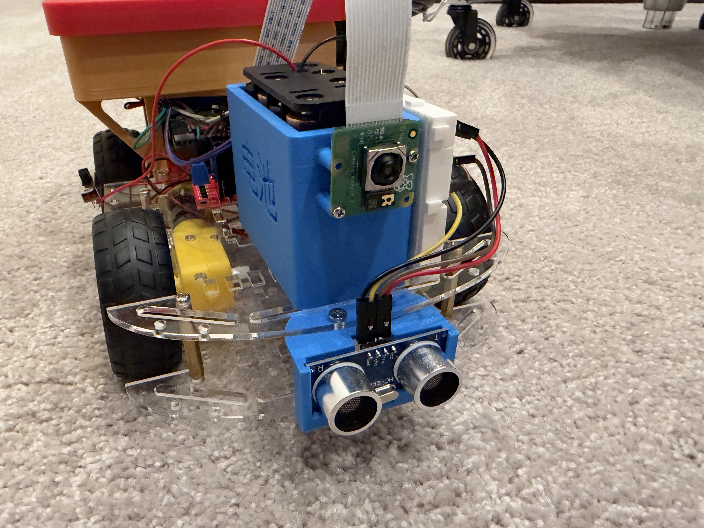
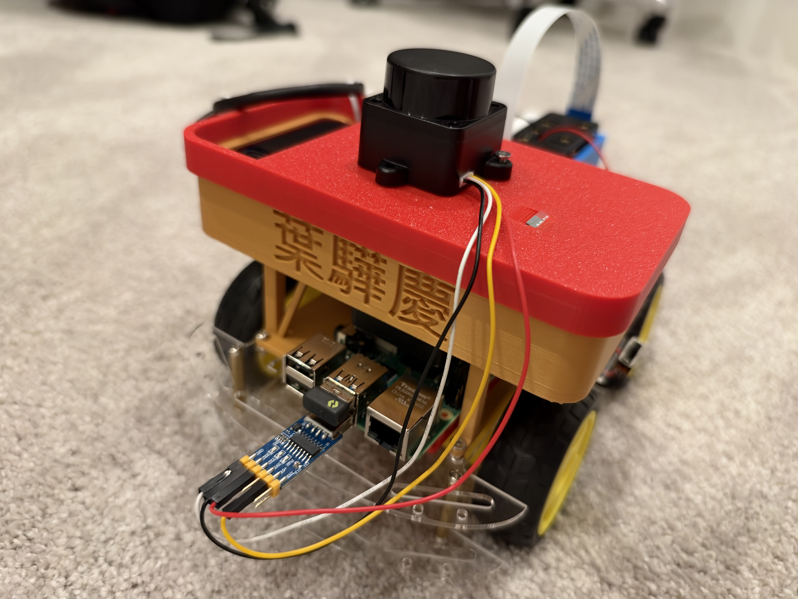

# LLM-Controlled-Robot

**Ratangga** is a small Raspberry Pi 4 robot that asks Claude where to go. It combines a camera,
a 360° LiDAR and a front ultrasonic sensor, and it drives smoothly while a local safety layer
keeps it off walls, people and edges. It runs ROS 2 Jazzy on Ubuntu 24.04.

**New to the robot? Start at [Step 1](#step-1-put-ubuntu-on-the-sd-card) and work down.**
The steps assume you have never used a Raspberry Pi or ROS before, and each one ends with a
check, so you know it worked before moving on.

| | |
|---|---|
| **Getting started** | [What you need](#what-you-need) · [Words used](#words-used-in-this-guide) · [How to stop it](#safety-how-to-stop-the-robot) · [1. Ubuntu](#step-1-put-ubuntu-on-the-sd-card) · [2. Connect](#step-2-connect-to-the-pi) · [3. ROS 2 Jazzy](#step-3-install-ros-2-jazzy) · [4. Robot code](#step-4-get-and-build-the-robot-code) · [5. First drive](#step-5-check-the-wiring-and-drive-by-keyboard) · [6. Run Ratangga](#step-6-let-claude-drive) |
| **Hardware setup** | [GPIO](#gpio-setup-motors-and-sensors) · [LiDAR](#lidar-setup-witmotion-d05) · [Camera](#rpi-camera-setup) · [Edge sensors](#edge-sensors-stops-falls) · [Motor power](#motor-power-pwm-and-carpet) |
| **More** | [CLAUDE.md](CLAUDE.md) (Ratangga's personality and rules) · [docs/DEVELOPMENT.md](docs/DEVELOPMENT.md) (how the code works) |

## What you need

| Front | Back (LiDAR on top, Raspberry Pi and wiring) |
|---|---|
|  |  |

- The robot, which has a **Raspberry Pi 4** (2 GB or more; 4 GB is easier), an L298N motor
  driver, four motors (the two left wheels share one L298N channel, the two right wheels the
  other), the LiDAR, the camera and the ultrasonic sensor.
- A **microSD card**, 32 GB or larger, and a way to plug it into your computer.
- **Power:** 8 fresh AA batteries for the motors, and a 5 V 3 A USB-C supply or power bank for
  the Pi. Use a mains USB-C supply while installing, because it takes a while.
- A computer (Mac, Windows or Linux) on the **same Wi-Fi** as the robot, and your Wi-Fi name
  and password.
- An **Anthropic API key**, so Claude can drive. You can make one at
  [console.anthropic.com](https://console.anthropic.com/). Everything up to Step 6 works
  without it.

You don't need a screen or keyboard for the Pi: you'll control it from your computer over
Wi-Fi.

### Words used in this guide

- **Terminal:** a window where you type commands. A grey box in this guide is a command:
  copy it, paste it into the terminal and press Enter. Lines starting with `#` are comments,
  and text after `#` on a line is ignored, so you can paste it too.
- **Copy and paste in a terminal:** select text with the mouse, then copy with **Cmd+C** on
  a Mac, **Ctrl+C** or right-click in Windows PowerShell / Windows Terminal, or
  **Ctrl+Shift+C** on Linux. Paste with **Cmd+V**, **Ctrl+V** / right-click, or
  **Ctrl+Shift+V**. With nothing selected, **Ctrl+C stops the running command** instead of
  copying, so on Linux always use Ctrl+Shift+C.
- **Commands that keep running:** some commands, such as starting the robot or
  `ros2 topic echo`, keep running and printing until you press **Ctrl+C**. When a box says
  "in a second terminal", leave the first one running, open another terminal window on your
  computer, connect to the Pi again (`ssh robot@ratangga.local`) and type it there.
- **SSH:** typing commands on the Pi from your own computer, over Wi-Fi.
- **`sudo`:** runs a command as administrator. It asks for your Pi password. Nothing is shown
  while you type it; that's normal.
- **ROS 2:** the software framework the robot runs on. Each program is a **node**; nodes talk
  by sending messages on named channels called **topics** (such as `/scan` for the LiDAR).
  A **launch** file starts several nodes at once.
- **Workspace:** the `ros2_ws` folder, where the robot's code is built.

### Safety: how to stop the robot

Press **Ctrl+C** in the terminal that started the robot. The motors stop straight away. If
that terminal is gone, switch off the motor battery. Keep the wheels off the ground (robot on
a box) whenever a step says so.

## Step 1: Put Ubuntu on the SD card

ROS 2 Jazzy runs on **Ubuntu 24.04**. Raspberry Pi OS won't work, because the ready-made ROS 2
Jazzy packages are built for Ubuntu 24.04 only.

1. On your computer, install **Raspberry Pi Imager** from
   [raspberrypi.com/software](https://www.raspberrypi.com/software/) and open it.
2. **Choose Device:** Raspberry Pi 4.
3. **Choose OS:** Other general-purpose OS → Ubuntu → **Ubuntu Server 24.04.x LTS (64-bit)**.
   Pick "Server", not "Desktop": the robot has no screen, and Server leaves more memory free.
4. **Choose Storage:** your microSD card. Everything on it will be erased.
5. Click **Next**, then **Edit Settings** when asked about OS customisation:
   - **General:** set the hostname to `ratangga`, choose a username (for example `robot`) and a
     password, enter your Wi-Fi name and password, and set your Wi-Fi country and time zone.
   - **Services:** tick **Enable SSH** and "Use password authentication".
   - Click **Save**, then **Yes** to apply the settings, then **Yes** to write the card.
6. When it says the write is finished, take out the card and put it in the Pi (the slot is on
   the underside).

### Without Raspberry Pi Imager

Any tool that writes a disk image to an SD card works. You set up Wi-Fi by editing a file on
the card instead of in Imager.

1. Download **Ubuntu Server 24.04 LTS (64-bit) for Raspberry Pi** from
   [ubuntu.com/download/raspberry-pi](https://ubuntu.com/download/raspberry-pi). The file
   ends in `.img.xz`. You don't need to unzip it.
2. Write it to the card with [balenaEtcher](https://etcher.balena.io/): **Flash from file** →
   pick the `.img.xz` → **Select target** → your microSD card → **Flash**. Double-check the
   target, because the card is erased.
3. Take the card out and put it back in. A drive called **system-boot** appears. Open the file
   `network-config` on it in a plain text editor (TextEdit in plain-text mode on a Mac,
   Notepad on Windows). Add your Wi-Fi below the `ethernets:` section, keeping these exact
   spaces (no tabs):
   ```yaml
   wifis:
     wlan0:
       dhcp4: true
       optional: true
       access-points:
         "YOUR-WIFI-NAME":
           password: "YOUR-WIFI-PASSWORD"
   ```
   Use a **2.4 GHz** network if your router has separate 2.4 and 5 GHz names.
4. Save, eject the card and put it in the Pi.

In Step 2, the username is `ubuntu` instead of `robot`, so use it wherever this guide says
`robot`. The `.local` name doesn't work yet, so find the Pi's IP address in your router's
device list (it shows up as `ubuntu`) and connect with, for example,
`ssh ubuntu@192.168.1.42`. The first password is `ubuntu`, and Ubuntu makes you choose a new
one straight away and then logs you out, so connect again with the new password. Then run
`sudo hostnamectl set-hostname ratangga`, so `ratangga.local` works after Step 2's reboot.
With no Wi-Fi at all, you can plug the Pi into your router with an Ethernet cable instead.

## Step 2: Connect to the Pi

1. Power on the Pi and **wait about 5 minutes**. The first boot sets everything up and may
   restart once. If it never shows up on your network, unplug the power, plug it back in and
   wait another 5 minutes. Wi-Fi sometimes only connects on the second boot.
2. On your computer, open a terminal: **Terminal** on a Mac, **PowerShell** on Windows. Then
   connect with the username you chose:
   ```bash
   ssh robot@ratangga.local
   ```
   Type `yes` the first time it asks about the fingerprint, then your password. Your prompt
   changes to `robot@ratangga:~$`, which means you are now typing **on the Pi**.

   If `ratangga.local` isn't found, look up the Pi's IP address in your Wi-Fi router's app or
   admin page (it's listed as `ratangga`) and use that, for example `ssh robot@192.168.1.42`.
3. Make `ratangga.local` always work, and bring the Pi up to date (this takes a few minutes):
   ```bash
   sudo apt update && sudo apt full-upgrade -y
   sudo apt install -y avahi-daemon git curl
   sudo reboot
   ```
   If apt says `Waiting for cache lock` or `Could not get lock ... held by process ...
   (unattended-upgr)`, Ubuntu is installing security updates in the background. This can
   take half an hour on a new Pi. Don't stop it or reboot: let apt wait, and it carries on by
   itself. If it gives up, run the same command again a few minutes later. This can happen at
   any `sudo apt` step in this guide. After `sudo reboot`, wait a minute and `ssh` in again.

**Every command from here on runs on the Pi, over SSH**, unless a step says otherwise.

## Step 3: Install ROS 2 Jazzy

ROS 2 (Robot Operating System) is the framework the robot's programs use to talk to each
other. These are the [official install steps](https://docs.ros.org/en/jazzy/Installation/Ubuntu-Install-Debs.html).
Copy each block in turn and paste it into the SSH window.

1. Set a UTF-8 language setting:
   ```bash
   sudo apt update && sudo apt install -y locales
   sudo locale-gen en_US en_US.UTF-8
   sudo update-locale LC_ALL=en_US.UTF-8 LANG=en_US.UTF-8
   export LANG=en_US.UTF-8
   ```
2. Add the ROS 2 package source:
   ```bash
   sudo apt install -y software-properties-common
   sudo add-apt-repository -y universe
   export ROS_APT_SOURCE_VERSION=$(curl -s https://api.github.com/repos/ros-infrastructure/ros-apt-source/releases/latest | grep -F "tag_name" | awk -F'"' '{print $4}')
   curl -L -o /tmp/ros2-apt-source.deb "https://github.com/ros-infrastructure/ros-apt-source/releases/download/${ROS_APT_SOURCE_VERSION}/ros2-apt-source_${ROS_APT_SOURCE_VERSION}.$(. /etc/os-release && echo ${UBUNTU_CODENAME:-${VERSION_CODENAME}})_all.deb"
   sudo dpkg -i /tmp/ros2-apt-source.deb
   ```
3. Install ROS 2 Jazzy. Use **ros-base**, which has no graphical tools, since the robot has no
   screen. This downloads about 1 GB and takes 10-20 minutes:
   ```bash
   sudo apt update && sudo apt upgrade -y
   sudo apt install -y ros-jazzy-ros-base ros-dev-tools ros-jazzy-demo-nodes-py
   ```
   If this fails with "unmet dependencies", run `grep '^Suites' /etc/apt/sources.list.d/ubuntu.sources`.
   The first line must read `Suites: noble noble-updates noble-backports` (the second,
   `Suites: noble-security`, is fine). Fix it with
   `sudo nano /etc/apt/sources.list.d/ubuntu.sources`, then run the two commands again.
4. Load ROS automatically in every new terminal, and set up `rosdep`, the tool that installs
   the robot code's dependencies:
   ```bash
   echo "source /opt/ros/jazzy/setup.bash" >> ~/.bashrc
   source ~/.bashrc
   sudo rosdep init
   rosdep update
   ```
5. **Check it works.** Start a test publisher:
   ```bash
   ros2 run demo_nodes_py talker
   ```
   Open a **second** terminal on your computer, `ssh robot@ratangga.local` again, and run
   `ros2 run demo_nodes_py listener`. If the second window prints `I heard: [Hello World: 1]`
   and counts up, ROS 2 works. Press **Ctrl+C** in both windows to stop.

## Step 4: Get and build the robot code

1. Set up GPIO (the pins the motors and sensors use) and the USB serial port (LiDAR), and
   install the Python packages the robot needs. [GPIO setup](#gpio-setup-motors-and-sensors)
   explains each line:
   ```bash
   sudo usermod -aG dialout,video $USER
   echo 'SUBSYSTEM=="gpio", KERNEL=="gpiochip*", GROUP="dialout", MODE="0660"' | \
       sudo tee /etc/udev/rules.d/99-gpio.rules
   sudo apt remove -y python3-rpi.gpio
   sudo apt install -y python3-pip python3-rpi-lgpio gpiod
   pip install --break-system-packages -U anthropic "brotli>=1.2"
   echo 'export LG_WD=/tmp' >> ~/.bashrc
   sudo reboot
   ```
   After the reboot, `ssh` in again.
2. Download the code and the LiDAR and camera drivers:
   ```bash
   git clone https://github.com/jjah0001/LLM-Controlled-Robot.git ~/LLM-Controlled-Robot
   cd ~/LLM-Controlled-Robot/ros2_ws
   vcs import src < robot.repos
   ```
3. Install the dependencies and build. The build takes a few minutes:
   ```bash
   rosdep install -y --from-paths src --ignore-src --rosdistro jazzy --skip-keys=libcamera
   colcon build --symlink-install --continue-on-error
   echo "source ~/LLM-Controlled-Robot/ros2_ws/install/setup.bash" >> ~/.bashrc
   source ~/.bashrc
   ```
   `rosdep` may ask for your password. The build prints many yellow compiler warnings from
   the LiDAR driver (`m1ct_d2`); ignore them, they are not errors.

   On a new Pi the build ends with `5 packages finished` and `1 package failed: camera_ros`.
   That's expected: the camera needs libcamera, which you build later in
   [RPi Camera setup](#rpi-camera-setup), and the rest of the robot works without it. Keep
   `--continue-on-error`: without it, colcon stops building everything else as soon as
   `camera_ros` fails, and nothing gets installed. If any other package fails, read the first
   error it prints. If it says `6 packages finished`, an older apt copy of libcamera is
   installed and `camera_ros` built against it. That copy usually can't stream from the Pi
   camera, so still do [RPi Camera setup](#rpi-camera-setup).
4. **Check GPIO** (no `sudo`, and with nothing else running):
   ```bash
   python3 ~/LLM-Controlled-Robot/tools/gpio_check.py
   ```
   It checks the library, the permissions and every sensor pin, and ends with
   `GPIO looks good.` If it reports a problem, it says how to fix it. See
   [GPIO setup](#gpio-setup-motors-and-sensors) for more.

To get updates later, update this repo and the drivers it pulled in, then rebuild:
```bash
cd ~/LLM-Controlled-Robot && git pull
cd ros2_ws
vcs import src < robot.repos      # puts each driver at the version this repo expects
vcs pull src/D05_lidar            # the LiDAR driver follows its main branch
colcon build --symlink-install --continue-on-error
```

## Step 5: Check the wiring and drive by keyboard

**Lift the robot so its wheels are off the ground** (put it on a box) for this whole step.

Check the wiring against this table. Pin numbers are the Pi's physical header pins, with the
GPIO (BCM) number in brackets. [pinout.xyz](https://pinout.xyz/) shows where each pin is.

| Part | Connection |
|---|---|
| L298N left motor | IN1 → pin 11 (GPIO17), IN2 → pin 15 (GPIO22), ENA → pin 12 (GPIO18) |
| L298N right motor | IN3 → pin 16 (GPIO23), IN4 → pin 18 (GPIO24), ENB → pin 35 (GPIO19) |
| L298N power | Motor battery + to `12V`, battery − to `GND`, **and** L298N `GND` to a Pi GND pin (for example pin 6). Remove the ENA/ENB jumpers so the Pi controls the speed. |
| Front ultrasonic (HC-SR04) | VCC → 5 V (pin 2), GND → GND, TRIG → pin 7 (GPIO4), ECHO → pin 13 (GPIO27) **through a voltage divider** (for example 1 kΩ and 2 kΩ), because ECHO is 5 V and would damage the Pi |
| LiDAR | USB port. See [LiDAR setup](#lidar-setup-witmotion-d05) |
| Camera | Ribbon cable in the CAMERA connector. See [RPi Camera setup](#rpi-camera-setup) |
| Edge sensors (optional) | See [Edge sensors](#edge-sensors-stops-falls) |

Put the 8 AA batteries in the motor battery holder. First spin each side on its own, without
ROS. The two left wheels turn forward for a second, then backward, and then the two right
wheels do the same:
```bash
python3 ~/LLM-Controlled-Robot/tools/gpio_check.py --motors
```

Then drive the motors through ROS with the keyboard. In one terminal, start the motor driver:
```bash
ros2 run motor_driver motor_driver_node --ros-args \
  --params-file ~/LLM-Controlled-Robot/ros2_ws/src/claude_ros/config/robot.yaml
```
In a second terminal (`ssh` in again), start the keyboard control:
```bash
ros2 run motor_driver keyboard_controller
```
Press **W** (forward), **S** (back), **A** (left), **D** (right), **X** (stop) and **Q**
(quit). The arrow keys work too. Hold a key down to keep moving: the wheels stop by
themselves about half a second after the last key press.

- If one side turns backwards on **W**, set `invert_left: true` or `invert_right: true`
  under `motor_driver:` in `ros2_ws/src/claude_ros/config/robot.yaml`. Then restart the motor
  driver.
- If **A** turns right, the sides are swapped: swap the left and right motor wires at the
  L298N.
- If the wheels hum but don't turn, the motor power is too low. See
  [Motor power](#motor-power-pwm-and-carpet).

Press **Ctrl+C** in both terminals when you're done.

**Before Step 6, set up the sensors.** Their instructions are further down this page:
1. [LiDAR setup](#lidar-setup-witmotion-d05), all five steps. The robot uses the LiDAR to
   avoid walls, so don't skip the direction check in its step 5.
2. [RPi Camera setup](#rpi-camera-setup). This takes the longest. If you want to try
   driving first, skip it and add `use_camera:=false` in Step 6.

Then come back to Step 6.

## Step 6: Let Claude drive

Before you start, check that the wheels turn the right way (Step 5) and that the LiDAR passed
its direction check ([LiDAR setup](#lidar-setup-witmotion-d05), step 5). Claude is asked for
a decision about every 2 seconds while the robot runs, and each one is a paid API call, so
stop the robot when you're not using it.

1. Store your API key on the Pi. It is a secret, so don't share it or commit it to git:
   ```bash
   echo 'export ANTHROPIC_API_KEY=sk-ant-...your key...' >> ~/.bashrc
   source ~/.bashrc
   ```
2. Put the robot on the floor in an open space, **away from stairs and table edges** unless
   you've fitted the [edge sensors](#edge-sensors-stops-falls). Stay close by the first time.
3. Start everything:
   ```bash
   ros2 launch claude_ros robot.launch.py
   ```
   Each decision appears in the log as a line from `claude_agent`, such as
   `[1.8s] lin=+0.40 ang=+0.10 for 4.0s | Heading for the open doorway` (the first number is
   how long Claude took to decide), or `[3.1s] drive +0.40m at 0.40 | ...` and
   `turn +90deg ...` for a fixed distance or turn, along with anything Ratangga says or
   remembers. A `No fresh /perception/summary` warning in the first second is normal while the
   sensors start up. Press
   **Ctrl+C** to stop it: the motors stop straight away.

   When you press Ctrl+C, the log may end with `KeyboardInterrupt` tracebacks and
   `process has died` lines. They're harmless: the motors were already stopped before them.

Useful options, added to the end of the launch line:

| Option | What it does |
|---|---|
| `mission:="Find the kitchen"` | Gives Ratangga a task. The default is to explore safely. |
| `use_agent:=false` | Starts the sensors and safety layer without Claude (no API key needed) |
| `use_camera:=false` / `use_lidar:=false` | Runs without that sensor |
| `use_cliff:=true` | Turns on the [edge sensors](#edge-sensors-stops-falls) |
| `surface:=carpet` | More motor power for carpet. See [Motor power](#motor-power-pwm-and-carpet) |
| `lidar_port:=/dev/ttyUSB1` | Uses a different LiDAR port |
| `model:=claude-haiku-5-5` | Uses a faster, cheaper Claude model |

All the settings are in `ros2_ws/src/claude_ros/config/robot.yaml`. To change Ratangga's
personality and rules, edit [CLAUDE.md](CLAUDE.md). Both take effect the next time you launch.

## GPIO setup (motors and sensors)

The motors, the front ultrasonic and the edge sensors are wired to the Pi's GPIO pins. The
robot's code uses the `RPi.GPIO` library. On Ubuntu 24.04 the classic version of that library
often fails with errors such as `Cannot determine SOC peripheral base address`, or only works
with `sudo`. The fix is **`python3-rpi-lgpio`**, a drop-in replacement from Ubuntu that
provides the same `RPi.GPIO` but uses the standard Linux GPIO device (`/dev/gpiochip0`). The
robot's code doesn't change, and nothing needs `sudo`.

Step 4 already does all of this. Here is what each part does, so you can check it or redo it:

1. **Use the right library.** Remove the classic one and install the replacement, plus
   `gpiod` for the `gpioinfo` tool:
   ```bash
   sudo apt remove -y python3-rpi.gpio
   sudo apt install -y python3-rpi-lgpio gpiod
   ```
   A copy of `RPi.GPIO` installed with `pip` would hide the Ubuntu one. Check which one
   Python uses:
   ```bash
   python3 -c "import RPi.GPIO as G; print(G.__file__)"
   ```
   It must print a path starting with `/usr/lib/python3/dist-packages/`. If it starts with
   `/usr/local/` or contains `.local`, run `pip uninstall --break-system-packages RPi.GPIO`
   (with `sudo` too if the path starts with `/usr/local/`). Don't go by `pip list`: it also
   shows the Ubuntu packages, so it lists `rpi-lgpio` even when everything is right.
2. **Allow your user to use the pins.** The robot's nodes run as your user, never as root.
   This rule gives the `dialout` group access to the GPIO device, and adds you to that group:
   ```bash
   echo 'SUBSYSTEM=="gpio", KERNEL=="gpiochip*", GROUP="dialout", MODE="0660"' | \
       sudo tee /etc/udev/rules.d/99-gpio.rules
   sudo usermod -aG dialout $USER
   sudo reboot
   ```
   After the reboot, `groups` must list `dialout`, and `ls -l /dev/gpiochip0` must show
   `crw-rw----` with `dialout`. Some Ubuntu images use a `gpio` group instead; showing `gpio`
   is fine too, as long as `groups` also lists `gpio`. `gpio_check.py` checks this for you.
3. **Give lgpio a folder for its temporary files.** lgpio creates small `.lgd-nfy*` files in
   the folder a program runs from. `export LG_WD=/tmp` (added to `~/.bashrc` in Step 4) keeps
   them in `/tmp` instead, so a robot started from any folder works.
4. **Run the check**, with no other robot program running:
   ```bash
   python3 ~/LLM-Controlled-Robot/tools/gpio_check.py            # library, permissions, sensors
   python3 ~/LLM-Controlled-Robot/tools/gpio_check.py --motors   # also spins each wheel: lift the robot!
   ```

**Rules that avoid most GPIO bugs with ROS:**
- **Never run ROS with `sudo`.** Root doesn't have your ROS setup, and it hides permission
  problems that come back later.
- **Only one program can use a pin at a time.** Stop the robot (**Ctrl+C**) before running
  `gpio_check.py` or `motor_driver_node` on its own. Don't start a second launch in another
  terminal. Never run the old `ros2 run ultrasonic_control motor_driver` demo with the robot,
  because it uses the same motor pins.
- **A crashed program frees its pins when it exits.** If a pin still seems busy, find and stop
  what's holding it: `ps aux | grep -E "ros2|python3"`, then `kill <number>`.

| Problem | Fix |
|---|---|
| `Cannot determine SOC peripheral base address`, `No access to /dev/mem` or `This module can only be run on a Raspberry Pi!` | The classic `RPi.GPIO` is in use. Do item 1, including the check of which copy Python uses. |
| `ModuleNotFoundError: No module named 'RPi'` | No GPIO library is installed (for example, the `apt remove` in item 1 worked but the `apt install` didn't). Run `sudo apt install -y python3-rpi-lgpio`. |
| `can not open gpiochip` or `Permission denied` | Do item 2. Then log out and back in, or reboot, so the group change applies. |
| `GPIO not allocated` or `GPIO busy` | Another program holds that pin. See the rules above. `gpioinfo` lists each pin and what's using it. |
| Error mentioning `.lgd-nfy` | Do item 3, then open a new terminal. |
| The check says OK but a wheel never turns | Not a GPIO problem: check the L298N motor power and that the ENA/ENB jumpers are removed, then see [Motor power](#motor-power-pwm-and-carpet). |
| The ultrasonic says "no echo" | Check its 5 V supply and the voltage divider on ECHO (Step 5 wiring table). |

## LiDAR setup (Witmotion D05)

The LiDAR uses the `m1ct_d2` driver from [jjah0001/D05_lidar](https://github.com/jjah0001/D05_lidar).
`vcs import src < robot.repos` clones it into `ros2_ws/src/D05_lidar`. Run the commands below
on the Pi, in `~/LLM-Controlled-Robot/ros2_ws` (`cd ~/LLM-Controlled-Robot/ros2_ws` first).

1. **Plug it in and find the port.** The USB adapter shows up as `/dev/ttyUSB0`:
   ```bash
   ls /dev/ttyUSB*
   sudo dmesg | tail        # should show a ch341 or cp210x converter attached to ttyUSB0
   ```
   If the port shows up and then vanishes, Ubuntu's braille driver has taken it:
   `sudo apt remove brltty`, then plug the LiDAR in again.
2. **Give your user access to the port** (one-time; log out and back in afterwards):
   ```bash
   sudo usermod -aG dialout $USER
   sudo cp src/D05_lidar/m1ct_d2/sc_mini.rules /etc/udev/rules.d/
   sudo udevadm control --reload-rules && sudo udevadm trigger
   ```
   The rules also create a stable name: `/dev/sc_mini` (CH340 adapter) or `/dev/sc_m_c`
   (CP210x). Use it as `lidar_port:=/dev/sc_mini` if `ttyUSB0` keeps changing.
3. **Build it** (the Step 4 build already does this):
   ```bash
   colcon build --symlink-install --packages-select m1ct_d2 && source install/setup.bash
   ```
4. **Test it on its own:**
   ```bash
   ros2 run m1ct_d2 m1ct_d2 --ros-args -p port:=/dev/ttyUSB0
   ros2 topic hz /scan          # in a second terminal: a steady rate means it works
   ```
   The driver prints lines like `scantime:0.10...` (and some Chinese status messages, which
   are normal). `ros2 topic hz` should print `average rate: 10.0` or close to it every second.
   Press **Ctrl+C** in both terminals to stop.
   To see the scan, run `rviz2` (on the Pi or a laptop on the same network), add a
   **LaserScan** display on `/scan`, and set **Fixed Frame** to `laser_link`.
5. **Check the orientation.** This matters for safety. Start the stack without Claude and
   watch the fused view:
   ```bash
   ros2 launch claude_ros robot.launch.py use_agent:=false use_camera:=false
   ros2 topic echo --full-length /perception/summary   # in a second terminal
   ```
   The second terminal prints a long line of readings five times a second. Find the part
   that starts `"lidar_sectors_m": {"front": ...`: these are the distances in metres in each
   direction. Hold a box about 30 cm in front of the robot, and the `front` number should
   drop to about `0.3`. Then move it to the robot's left, and `left` should drop. If the box
   shows up in the wrong sector, edit `ros2_ws/src/claude_ros/config/robot.yaml` (for example
   with `nano`), then stop the launch with **Ctrl+C** and start it again:
   - The front reading appears in another sector: set `lidar_yaw_offset_deg` to the angle
     between the LiDAR's zero mark and the robot's front (for example `180` or `-90`).
   - Left and right are swapped: set `lidar_reverse: true`.
   - Also set `lidar_to_front_m`, `lidar_to_rear_m` and `robot_half_width_m` to your robot's
     measurements, so the robot stops at the right distance.

| Problem | Fix |
|---|---|
| `Permission denied` on `/dev/ttyUSB0` | Do step 2, then log out and in. |
| `node_lidar init error` | Wrong port or the LiDAR isn't spinning. Check `ls /dev/ttyUSB*` and the USB cable. |
| `unrecognized option '--ros-args'`, then `Couldn't parse remap rule` and `process has died` | An old copy of the driver. In `ros2_ws`: `vcs pull src/D05_lidar`, then rebuild. |
| `[robot.launch] m1ct_d2 not found` | Run `vcs import src < robot.repos` in `ros2_ws`, then rebuild. |
| Robot thinks something is always in front | The robot's own body is in the scan. Raise `lidar_self_filter_m`. |

## RPi Camera setup

**Why it usually fails on Ubuntu:** the `ros-jazzy-camera-ros` apt package comes with the
*upstream* libcamera. It often finds the camera (it may even list it) but then can't stream
pictures from it: the log shows `IPAProxy ... Failed to call start: -110` and no images arrive.
Reliable Pi camera support on this robot's **Raspberry Pi 4** comes from **Raspberry Pi's
libcamera fork**, built from source next to `camera_ros`. Ubuntu also blocks the memory
buffers libcamera needs, unless you allow them (step 3).

Run the commands below on the Pi, in `~/LLM-Controlled-Robot/ros2_ws`.

1. **Connect the cable** with the Pi powered off. On the Pi 4, the camera port is the
   connector labelled CAMERA, between the micro-HDMI ports and the audio jack (not the DISPLAY
   connector by the SD card). Lift the latch, insert the ribbon with its metal contacts facing
   the HDMI ports (blue tab towards the USB/Ethernet ports), and press the latch down.
2. **Enable the camera** in `/boot/firmware/config.txt`. Open it with
   `sudo nano /boot/firmware/config.txt`, make sure these two lines are in it:
   ```ini
   camera_auto_detect=1
   dtoverlay=vc4-kms-v3d
   ```
   and put a `#` at the start of any `start_x=1` line (the old legacy camera stack, which
   libcamera cannot use). If there is a `dtoverlay=vc4-fkms-v3d` line (note the extra **f**,
   often under `[pi4]`), change it to `dtoverlay=vc4-kms-v3d`. Save with **Ctrl+O**, **Enter**,
   leave with **Ctrl+X**, then `sudo reboot`. If the camera is still not found, turn auto
   detection off and name the sensor:
   ```ini
   camera_auto_detect=0
   dtoverlay=imx708        # Camera Module 3   (imx219 = Module 2, ov5647 = Module 1, imx477 = HQ)
   ```
   Check that the kernel sees it: `sudo dmesg | grep -iE 'imx|ov5647'` should list the sensor,
   and `ls /dev/media*` should show some devices.
3. **Allow camera access** (once):
   ```bash
   sudo usermod -aG video $USER
   echo 'SUBSYSTEM=="dma_heap", GROUP="video", MODE="0660"' | sudo tee /etc/udev/rules.d/99-dma-heap.rules
   sudo udevadm control --reload-rules && sudo udevadm trigger   # then log out and back in
   ```
4. **Remove the apt camera packages**, if you installed them, so they don't get picked up
   instead of the fork:
   ```bash
   sudo apt remove ros-jazzy-camera-ros ros-jazzy-libcamera
   ```
5. **Build libcamera (Raspberry Pi fork) and camera_ros** in the workspace. The first build
   takes about 20-40 minutes on a Pi 4:
   ```bash
   sudo apt install -y python3-colcon-meson meson ninja-build pkg-config python3-yaml python3-ply \
     python3-jinja2 libyaml-dev libgnutls28-dev openssl libdw-dev libunwind-dev libudev-dev \
     libevent-dev libdrm-dev libjpeg-dev libtiff-dev nlohmann-json3-dev
   vcs import src < camera.repos            # clones a tested raspberrypi/libcamera release into src/libcamera
   rosdep install -y --from-paths src --ignore-src --rosdistro jazzy --skip-keys=libcamera
   colcon build --packages-select libcamera --meson-args \
     -Dpipelines=rpi/vc4 -Dipas=rpi/vc4 -Dcam=enabled \
     -Dgstreamer=disabled -Dqcam=disabled -Dpycamera=disabled -Ddocumentation=disabled \
     -Dtest=false -Dlc-compliance=disabled
   colcon build --symlink-install           # camera_ros and the rest; later builds just use this
   source install/setup.bash
   ```
   (`rpi/vc4` is the Pi 4's camera pipeline.) If the Pi runs out of memory while building
   (likely on a 1-2 GB Pi 4), add `--executor sequential`, and if it still fails, add swap:
   `sudo fallocate -l 2G /swapfile && sudo chmod 600 /swapfile && sudo mkswap /swapfile && sudo swapon /swapfile`.
6. **Test it**:
   ```bash
   cam -l                                   # must list the camera, e.g. 'imx708_wide'
                                            # (if `cam` is not found: install/libcamera/bin/cam -l)
   ros2 launch claude_ros robot.launch.py use_lidar:=false use_agent:=false
   ros2 topic hz /camera/image_raw          # in a second terminal: a steady rate
   ```
   `ros2 topic hz` should print an `average rate:` line every second. If it prints nothing,
   no images are arriving: look in the launch terminal for errors and check the table below.
   The camera log is long and colourful; an `INFO` line saying `Registered camera` is good.
   To see the picture, run `ros2 run rqt_image_view rqt_image_view` on a computer on the
   same network (`sudo apt install ros-jazzy-rqt-image-view`).

| Problem | Fix |
|---|---|
| Camera is found but no images arrive; log shows `Call timeout!` and `Failed to call start: -110` | camera_ros is using the apt (upstream) libcamera. Do step 4, then step 5 and rebuild from clean: `rm -rf build/camera_ros install/camera_ros`. |
| `no cameras available` | `cam -l` is empty too: check the cable and step 2. `cam -l` works: camera_ros is using the wrong libcamera (step 4, then rebuild from clean: `rm -rf build/camera_ros install/camera_ros`). |
| `Could not open any dma-buf provider` / `Failed to allocate buffers` | Step 3 (log out and back in). Still failing: lower `width`/`height` in `robot.yaml`. |
| Image is zoomed in (Camera Module 2) | Set `sensor_mode: "1640:1232"` under `camera:` in `robot.yaml`. |
| Image is upside down | Change `orientation` under `camera:` in `robot.yaml`: the default is `180` (for this robot's upside-down mount), so set `0`, or `180` if you changed it. |
| Error that `camera_calibration_parsers` can't open a calibration file | Harmless: the robot doesn't need a calibrated camera. |
| Warnings `unsupported control: AfWindows` or `Could not set AF_PAUSE` / `AF_TRIGGER` | Harmless autofocus messages from the Camera Module 3. |
| `[robot.launch] camera_ros not found` | `camera_ros` didn't build: rerun step 5 and read the first error. |
| `camera_ros` fails with `libcamera::Span ... is deprecated` | `src/libcamera` or `src/camera_ros` is newer than the tested versions in the `.repos` files. Run `vcs import src < camera.repos && vcs import src < robot.repos`, then all of step 5 again from `rosdep install`. |
| Need more detail | `LIBCAMERA_LOG_LEVELS=*:DEBUG ros2 run camera_ros camera_node` |

If the camera still won't cooperate, the robot runs without it: launch with
`use_camera:=false`. Whenever the latest picture is more than a second old (the
`image_timeout_s` setting), Claude is told the camera is unavailable and decides from the
LiDAR and ultrasonic distances alone.

## Edge sensors (stops falls)

The LiDAR and ultrasonic look straight ahead, so **they cannot see a drop**. A floor that ends
looks like open space to them. Software alone can't fix that. Without extra sensors, the only
protection is Claude watching the camera (it is told to keep at least 0.5 m from any edge it
sees), and that isn't reliable enough to count on. **Fit downward-facing IR edge sensors**
before letting the robot drive near stairs or on a table.

**Parts:** two digital IR reflectance modules (TCRT5000 boards, a few dollars each, with a
digital `DO`/`OUT` pin and a sensitivity potentiometer).

**Mounting:** one under each front corner, pointing straight down, about 5-10 mm above the
floor and **at least 5 cm in front of the wheels**. The robot needs that much room to stop.
Put them at the corners, not in the middle: if the robot meets an edge at a shallow angle, a
corner reaches it first.
Add a third one at the back if the robot often reverses: wire it like the others to a free
GPIO pin, then add `rear` to `sensor_names` and its BCM pin number to `sensor_pins` under
`cliff_publisher:` in `robot.yaml`.

**Wiring** (power the modules from 3.3 V so their output is safe for the Pi's GPIO; any 3.3 V
and GND header pins will do):

| Module pin | front_left | front_right |
|---|---|---|
| VCC | 3.3 V (pin 1) | 3.3 V (pin 17) |
| GND | GND (pin 9) | GND (pin 25) |
| DO / OUT | GPIO5 (pin 29) | GPIO6 (pin 31) |

**Set up and test:**
1. With the robot on the floor, turn each module's potentiometer until its LED is on. Then lift
   the robot about 3 cm: the LED must go off. Check this on your darkest floor or carpet too,
   since dark surfaces reflect less IR.
2. Start the robot with the edge sensors on:
   ```bash
   ros2 launch claude_ros robot.launch.py use_cliff:=true
   ros2 topic echo /cliff          # second terminal: lift the front, "front" must become true
   ```
3. Table test. Keep one hand ready to catch the robot the whole time. Put it on a table,
   about 30 cm from an edge, facing the edge. Start it without Claude:
   `ros2 launch claude_ros robot.launch.py use_cliff:=true use_agent:=false`. In a second
   terminal, send it a slow forward command:
   ```bash
   ros2 topic pub --rate 2 /claude/intent std_msgs/String \
     "{data: '{\"linear\":0.15,\"angular\":0.0,\"duration_s\":1.0,\"reason\":\"edge test\"}'}"
   ```
   It must stop while its front wheels are still well on the table. Press **Ctrl+C** in the
   second terminal to stop sending the command, then in the first.

Both modules can share the 3.3 V supply. Never power them from 5 V: their output would then
be 5 V, which can damage the Pi's GPIO.

**What the robot does:**
- **Edge ahead:** forward travel stops immediately, without the usual gentle slow-down. The
  robot may still turn in place or back away, and Claude is told to back off and turn away.
- **Sensors silent:** with `use_cliff:=true`, the robot will not drive forward or backward
  until `/cliff` is publishing again.
- **Loose wire:** reads as an edge, so the robot stops.
- **Very dark floor or rug:** may also read as an edge, because it reflects little IR, so the
  robot refuses to drive onto it. Turn the potentiometer up a little (step 1), but re-check
  that lifting the robot still turns the LED off.

Claude is also told to keep half a metre from any edge it sees in the camera and to note it in
memory, but the sensors are what actually stop a fall.

Pins, the "no floor" level and the debounce are under `cliff_publisher:` in `robot.yaml`. To
always use the sensors, change the `use_cliff` default to `'true'` in
`ros2_ws/src/claude_ros/launch/robot.launch.py`.

## Motor power (PWM and carpet)

Wheel commands are mapped onto a PWM duty range, `min_duty`..`max_duty`. `min_duty` is the
power used at the slowest speed, and it needs to be just high enough for the wheels to turn.
Carpet needs more power than a hard floor, so there are two presets:

| Setting (`motor_driver` in `config/robot.yaml`) | Default | Meaning |
|---|---|---|
| `surface` | `hard_floor` | Active preset: `hard_floor` or `carpet` |
| `hard_floor_min_duty` | `60` | Minimum duty % on wood, tiles, lino |
| `carpet_min_duty` | `80` | Minimum duty % on carpet and rugs |
| `min_duty` | `-1` | Set to 0-100 to override both presets (`-1` = use the preset) |
| `max_duty` | `100` | Duty % at full speed (lower it to cap power) |
| `kick_duty` | `100` | Duty % for a short burst when a wheel starts or reverses |
| `kick_s` | `0` (off) | Length of that burst in seconds. On carpet try `0.15`-`0.3` |

The **start kick** helps on carpet because a wheel needs more power to start turning than to
keep turning. With a kick, `min_duty` can stay lower, so slow driving stays smooth.

You can change these at start-up, or while the robot is running, without restarting:

```bash
ros2 launch claude_ros robot.launch.py surface:=carpet      # start in carpet mode
ros2 launch claude_ros robot.launch.py min_duty:=85 kick_s:=0.25

ros2 param set /motor_driver surface carpet                 # switch while running
ros2 param set /motor_driver carpet_min_duty 90.0           # tune the carpet preset
ros2 param set /motor_driver min_duty 70.0                  # fixed override
ros2 param set /motor_driver min_duty -1.0                  # back to the presets
ros2 param set /motor_driver kick_s 0.25                    # turn on the start kick
ros2 topic echo /motor_driver/power                         # what's active now
```

Type values with a decimal point (`90.0`, not `90`). Invalid values (outside 0-100, or a minimum
above the maximum) are rejected with a message, and the old value stays.
Ratangga can also switch the preset itself. If it keeps asking to move but its distance readings
don't change, it assumes the wheels are stalling and switches to `carpet`. It switches back
when the camera shows a hard floor again.

**Finding your numbers:** the robot will drive forward slowly, so put it on the floor
with at least 2 m of open space in front (the safety layer stops it before a wall). Run
`ros2 launch claude_ros robot.launch.py use_agent:=false`, then in another terminal send a
slow forward command through the safety layer. It keeps driving until you press **Ctrl+C**
in that terminal:

```bash
ros2 topic pub --rate 2 /claude/intent std_msgs/String \
  "{data: '{\"linear\":0.15,\"angular\":0.0,\"duration_s\":1.0,\"reason\":\"duty test\"}'}"
```

In a third terminal, lower `min_duty` step by step with `ros2 param set /motor_driver
min_duty ...` until the wheels stop turning, then set the preset about 5 above that value.
Do this once on a hard floor and once on carpet. Copy the results into
`ros2_ws/src/claude_ros/config/robot.yaml` so they stick.
